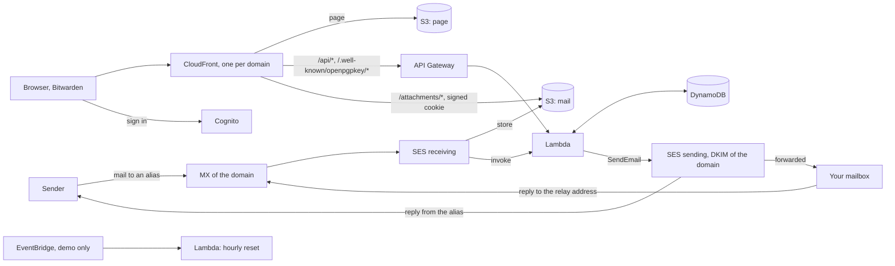
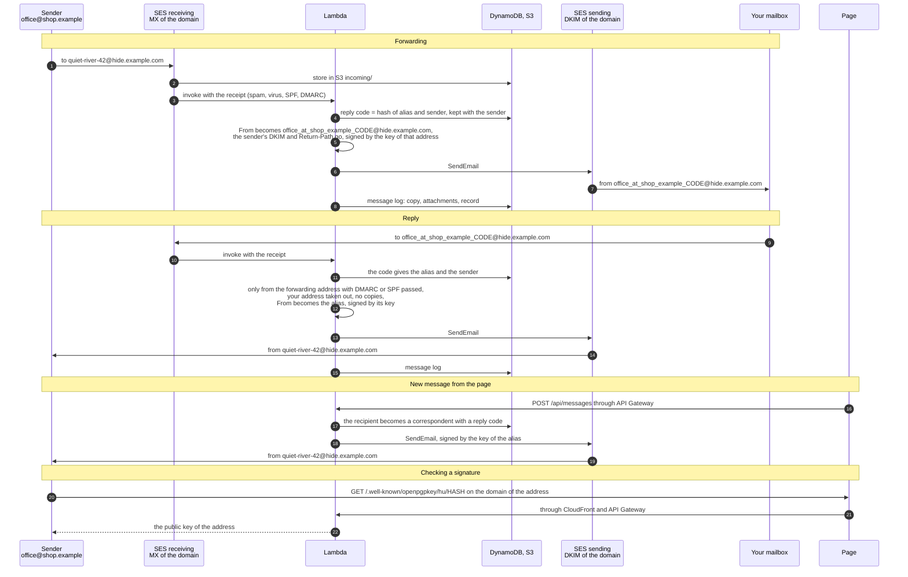

# Hide My Email

Disposable email addresses on your own domains, like Apple's Hide My Email, running serverless on AWS. Mail to an alias lands in your personal inbox; you reply from the alias, and nobody ever sees your personal address. Aliases are made on a web page, through an API, or straight from the Bitwarden password generator and the addy.io browser extension.

Everything is Terraform and AWS managed services; the logic is one Python Lambda without dependencies. Nothing runs while nobody writes, so a personal installation costs cents a month (see [Cost](#cost)).

## Demo

**<https://dkvhfbgof6jkv.cloudfront.net>**

Sign in with `demo@example.com` / `Demo-Password-1` (the fields are filled in for you).

The demo has **no mail**: it neither receives nor sends a single message. Everything else works on example data — create, edit, switch off, pin and delete aliases, sort and search them, read the example messages with their attachments, add correspondents to an alias and get their reply addresses, make an API key and create aliases with it (for example from Bitwarden), switch the language. The demo is public and goes back to its initial state **every hour**: aliases, API keys and the message log are wiped, the examples of [`seed/seed.json`](seed/seed.json) are written again, the demo password is put back and any other user is deleted. Changing the password and two-factor authentication are hidden in the demo, so no visitor can lock the others out.

## Features

- **Aliases** like `quiet-river-42@hide.example.com` or a name of your own, each with a comment, its own forwarding address (or the default one), its own sender name for replies, on/off, pinned. Sorted by creation date, comment, last message or number of messages; search by address, comment, forwarding address or a relay address.
- **Forwarding** from a relay address that shows who wrote, as Apple does: mail from `office@shop.example` arrives from `office_at_shop_example_<code>@hide.example.com`, with the sender's name as the display name.
- **Replies** to the relay address go back to the original sender from the alias. Your personal address is taken out of the quoted text and the headers, copies (`Cc`) are not sent, and only your own mailbox may reply (SES must see DMARC, or SPF, pass).
- **Correspondents and new conversations**: the dialog of an alias lists everyone with a reply address for it, who wrote or whom you added. Adding someone (`bob@shop.example`) makes their reply address (`bob_at_shop_example_<code>@hide.example.com`) at once: mail to it from your forwarding address goes to them from the alias, so a conversation can start from your own mail client.
- **New message from the page**: from an alias, to anyone, a subject and plain text (no attachments). The recipient becomes a correspondent of the alias and the message goes to the log.
- **OpenPGP signatures** on everything SES sends, both ways: replies and new messages carry the key of the alias, forwarded mail the key of the relay address it comes from. The keys are published in the Web Key Directory of each domain, where mail clients find them by address. A switch in the settings stops the signatures; `pgp_enabled = false` removes PGP altogether.
- **Message log**: every forwarded message, every reply and every new message, kept until you delete it. Messages are shown as text only (HTML is converted, so no script runs and no tracker loads); attachments are downloaded through CloudFront with a signed cookie.
- **Several domains**: each with its own SES identity, DKIM, MAIL FROM, DMARC, BIMI, certificate and copy of the page.
- **API** compatible with [addy.io](https://app.addy.io/docs/): the Bitwarden username generator and the addy.io browser extension create and manage aliases with a personal API key.
- **Version**: Settings → Version shows the version of the site and the releases of the demo repository that came after it, with their notes.
- **Account**: two-factor authentication with an authenticator app (TOTP), password change, API keys, interface in English, Russian, French and Italian.

## Compared with other services

Other alternatives solve the same problem well; the difference is who runs the service and whose domain the addresses are on.

| | 🛡️ **Hide My Email** (this project) | 🔀 **Other alternatives** |
| --- | --- | --- |
| 🏢 **Who runs it** | ✅ You, in your own AWS account and region | ❌ The provider |
| 👀 **Who can read your mail in transit** | ✅ Nobody but AWS as your processor | ⚠️ The provider |
| 🌐 **Domain of the aliases** | ✅ Always your own, any number of domains | ⚠️ The provider's domain; your own only on some services and paid plans |
| 🔁 **Addresses survive a change of provider** | ✅ Yes: move the MX, keep every address | ⚠️ Only with your own domain |
| ♾️ **Number of aliases** | ✅ Unlimited (optional cap) | ⚠️ Often limited on free plans |
| ↩️ **Reply from the alias** | ✅ Yes, relay addresses show the sender | ✅ Yes |
| ✍️ **Start a conversation from the alias** | ✅ Yes, from the page or from your mail client through a reply address | ⚠️ Some services (reverse aliases, often paid) |
| 💰 **Price** | ✅ AWS usage, about $0.75 a month ([Cost](#cost)) | 💳 A subscription for anything beyond the free plan |
| 📖 **Open source, self-hostable** | ✅ MIT, one `terraform apply` | ⚠️ Some of them |
| 🖥️ **Servers to run** | ✅ None: serverless, nothing to patch | ⚠️ A server to maintain, if self-hosted |
| 🔌 **API, Bitwarden, browser extension** | ✅ addy.io-compatible: Bitwarden and the addy.io extension | ⚠️ Depends on the service |
| 🔐 **PGP encryption of forwarded mail** | 🔜 Planned | ⚠️ Some of them |
| 📨 **Message log with attachments** | ✅ Text-only view, kept in your bucket | ❌ Usually not |

What you get by running it yourself:

- 🌐 **Your own domain.** Aliases are `…@hide.your-domain`, not a service's domain that sites may block as "disposable". Since the domain is yours, the addresses outlive this project or any provider: point the MX elsewhere and every address still works.
- 🕵️ **Nobody in the middle.** Mail passes only through AWS services in your account and region: no company between you and your mail reads, profiles or can lose it, and there is no account of yours on another service to be breached or closed.
- 🔒 **Encryption and private storage.** TLS on every hop that the sending server supports (SES receiving takes TLS, SES sending uses it whenever the receiving server does), HTTPS only on the page and the API, S3 server-side encryption for stored mail and attachments, DynamoDB encryption at rest, the attachment signing key as an SSM SecureString. Buckets are private and readable only by the stack's CloudFront distributions; API keys are stored as SHA-256 hashes.
- 🧱 **A small, auditable attack surface.** No servers or containers to patch: managed services, one Python function without dependencies, least-privilege IAM roles, a strict content security policy with pinned scripts, a page that never renders a message's HTML. Deploys use GitHub OIDC with no long-lived AWS keys.
- 🔑 **Strong sign-in.** Cognito with no self sign-up, optional two-factor authentication with an authenticator app, short-lived tokens.
- ✉️ **Aligned authentication.** SPF, DKIM and DMARC of your own domain, BIMI with your logo (see [Deliverability and spam](#deliverability-and-spam)).
- 💸 **It costs cents.** Pay-per-use AWS pricing, mostly within the free allowances.

⚖️ What the services do better: they need no AWS account and no SES production access, some already encrypt forwarded mail with PGP (planned here), and someone else watches the deliverability of their domains. The message log here keeps copies of your mail in your own bucket — convenient, but delete what you do not need, or empty the log from the page.

## How it works



| Part | Service |
| --- | --- |
| Receiving | SES receipt rule for every alias domain: the message is stored in S3 (`incoming/`, 30 days), then the Lambda is invoked |
| Forwarding and replies | Lambda `lambda/hide_my_email.py` (Python, arm64), SES sending with DKIM and MAIL FROM of the domain |
| Data | DynamoDB on demand, one table: aliases, reply codes, the message log, API keys (hashes only) |
| Message log | S3 `messages/` (copies) and `attachments/` (one object per attachment), kept until deleted |
| Page | S3 + CloudFront per domain (or one on `*.cloudfront.net` without domains), module [`site/`](site/) |
| Sign-in | Cognito user pool, no self sign-up, optional TOTP |
| API | API Gateway HTTP API: `/api/*` with a Cognito JWT authorizer, `/api/v1/*` (addy.io) with an API key checked by the Lambda |
| Signatures | Ed25519 OpenPGP keys derived from a secret in SSM (`pgp.tf`), never stored; `cryptography` in a Lambda layer built while planning; Web Key Directory through CloudFront and API Gateway |
| Attachments | CloudFront `/attachments/*` with a one-hour signed cookie set by the API (`trusted_key_groups`, key in SSM) |
| Demo reset | Lambda `lambda/reset.py`, EventBridge `rate(1 hour)` |

### How mail moves



The demo has no mail: only the page part works there, and nothing is sent.

### OpenPGP signatures and the Web Key Directory

Every message SES sends is signed with OpenPGP as PGP/MIME (`multipart/signed`, RFC 3156):

| Message | From | Signed by the key of |
| --- | --- | --- |
| Reply to a correspondent | `quiet-river-42@hide.example.com` | the alias |
| New message from the page | `quiet-river-42@hide.example.com` | the alias |
| Forwarded to you | `office_at_shop_example_<code>@hide.example.com` | that relay address |

So the signer is always the address in `From`. Each key is an Ed25519 key (OpenPGP v4) with the address as its only user id and no expiry, so it tells nothing about you. The keys are published in the Web Key Directory (WKD, direct method) of the domain, `https://hide.example.com/.well-known/openpgpkey/hu/<hash>`. GnuPG, Thunderbird, Kleopatra, Mailvelope, Proton Mail and FairEmail/OpenKeychain find them by the sender's address, and the signature names the signer's address (Signer's User ID), so `gpg --auto-key-retrieve` knows where to look:

```bash
gpg --locate-keys --auto-key-locate clear,wkd quiet-river-42@hide.example.com
```

The dialog of an alias shows its key: the fingerprint (a click copies it), the WKD link and "Download key (.asc)".

No private key is stored. The function derives each key from a secret in SSM (`/<name>/pgp-secret`, `pgp.tf`) and the local part; the alias keeps only the time its key was made (`pgp_created`), which fixes the fingerprints of the alias and of its relay addresses. The secret is kept from being destroyed (`prevent_destroy`): a new one would give every address a new key, and the mail already sent would no longer check against the keys in WKD. The same protection makes `terraform destroy` refuse until it is lifted by hand. If signing fails, the message still goes out, unsigned, with the error in the Lambda log.

Before signing, text parts are turned into quoted-printable and the others into base64, so that no server on the way re-encodes them and breaks the signature. Parts a sender signed or encrypted themselves (`multipart/signed`, `multipart/encrypted`) stay as they are, with their own signature intact. Recipients without OpenPGP (Gmail, Outlook) see a `signature.asc` attachment.

Two switches:

- **Settings → PGP → Sign outgoing mail** (kept in DynamoDB; `PUT /api/settings/pgp` with `{"signing": false}`). Off, mail goes out without `signature.asc` and the aliases show no key. WKD keeps serving the keys, so the mail already sent can still be checked, and switching back on gives the same keys. The demo reset switches it back on.
- **`pgp_enabled = false`** removes PGP altogether: no signatures, no PGP tab, no key on the page, no WKD (route in API Gateway, path and header in CloudFront), no layer and so no build while planning. Only the secret stays, so that `true` again gives every address the same key.

The demo has no mail, so it signs nothing, but it shows the keys and serves WKD at its `*.cloudfront.net` address.

A reply code is 12 characters of a SHA-256 of "alias + sender", so one sender always gets the same relay address; the readable part before it is only for people. The full data model is in the docstring of [`lambda/hide_my_email.py`](lambda/hide_my_email.py).

## Test environment and production

The defaults deploy the **test environment**, the public demo above. It is the same code with mail turned off:

- no domains: nothing is created in SES, no DNS is touched, no MX points anywhere; the page answers at its `*.cloudfront.net` address with CloudFront's certificate;
- aliases show the placeholder domain `demo_domain` (`hide.example.com`), and the API answers `mail_disabled` where mail would be needed (verifying a forwarding address, sending a new message); correspondents can still be added;
- the sign-in is published and filled in (`demo = true`), password change and two-factor authentication are hidden;
- the hourly reset (`reset_schedule`) rebuilds everything from `seed/seed.json`, and `max_aliases` / `max_tokens` / `max_relays` keep visitors from filling the table;
- point-in-time recovery is off and the buckets are deleted with their content on `terraform destroy`.

**Production** turns mail on by listing domains. Start from [`examples/production.tfvars`](examples/production.tfvars):

| Variable | Test environment (default) | Production |
| --- | --- | --- |
| `name` | `hme-demo` | `hide-my-email` — the prefix of every resource |
| `demo` | `true` — published sign-in | `false` |
| `domains` | `[]` — no mail | `[{ name = "hide.example.com", route53_zone = "example.com" }, …]` |
| `forward_to` | `you@example.com` | your personal address |
| `verify_forward_to` | `false` | `true` while the SES account is in the sandbox |
| `admin_email` | `demo@example.com` | your address |
| `admin_password` | `Demo-Password-1` | `""` — Cognito mails a temporary password |
| `reset_schedule` | `rate(1 hour)` | `""` — no reset, no examples |
| `max_aliases`, `max_tokens`, `max_relays` | `100`, `20`, `200` | `0` — no limit |
| `pgp_enabled` | `true` | `true` — OpenPGP signatures and WKD; `false` removes them |

Steps to production:

1. Pick a fresh `name` (and state key): production is a separate deployment, not a change of the demo.
2. List the domains. With `route53_zone` the stack writes every record (MX, DKIM, MAIL FROM, DMARC, BIMI, certificate validation, A/AAAA of the page). Without it, the records to add at your DNS host are in `terraform output -json dns_records`; the certificate is validated by one of them, so the first apply of such a domain goes in two steps:
   1. `terraform apply -target='module.site["hide.example.org"].aws_acm_certificate.this'`, add its validation CNAME (`aws acm describe-certificate --region us-east-1 …`) and the mail records;
   2. `terraform apply` — it waits for the certificate (up to 30 minutes) and creates the distribution; then add the site's CNAME. It shares the name with the MX record, so the DNS host must flatten it (Cloudflare: CNAME flattening).
3. Only one SES receipt rule set is active in a region; the stack activates its own. Another stack receiving mail in the same region has to add its rules to it. Check with `aws ses describe-active-receipt-rule-set`.
4. After apply: open the verification link AWS mails to `forward_to`, sign in with the temporary password Cognito mails to `admin_email`, and request SES production access for the region (SES console → Account dashboard): in the sandbox SES sends only to verified addresses, so replies to strangers are not sent.

## Deploy

### What you need

1. An S3 bucket for Terraform state (the S3 backend with the native lockfile, Terraform 1.10+; no DynamoDB lock table).
2. The GitHub OIDC provider in the AWS account (`https://token.actions.githubusercontent.com`, audience `sts.amazonaws.com`) and a role for this repository. The role trusts only jobs of the GitHub environment `demo`:

   ```json
   {
     "Effect": "Allow",
     "Principal": { "Federated": "arn:aws:iam::<account>:oidc-provider/token.actions.githubusercontent.com" },
     "Action": "sts:AssumeRoleWithWebIdentity",
     "Condition": {
       "StringEquals": {
         "token.actions.githubusercontent.com:aud": "sts.amazonaws.com",
         "token.actions.githubusercontent.com:sub": "repo:<owner>/Hide-My-Email:environment:demo"
       }
     }
   }
   ```

   Its permissions: everything named with the `name` prefix (`s3:*` on `arn:aws:s3:::hme-demo-*`, the table, functions and Lambda layers, roles with `iam:PassRole`, log groups, SSM parameters under `/hme-demo/`, the EventBridge rule), API Gateway, Cognito and CloudFront (their ids are generated), log delivery for API access logs, and the state objects under the state key prefix. The demo needs no SES, ACM or Route 53; production adds them.
3. In the GitHub repository: the environment `demo`, and the variables `AWS_ROLE_ARN` (the role) and `TF_STATE_BUCKET` (the state bucket). There are no secrets.
4. Python 3 with pip (or the venv module) and access to PyPI where Terraform plans: `lambda/build_layer.py` fetches the `cryptography` wheels of `lambda/requirements.txt` for Linux arm64 into `.build/layer`. The same versions give the same zip, so the layer changes only with them. Not needed with `pgp_enabled = false`.

### GitHub Actions

[`.github/workflows/terraform.yml`](.github/workflows/terraform.yml) only calls the shared workflow of [Tozapid/demo-ci-cd-skeleton](https://github.com/Tozapid/demo-ci-cd-skeleton); the same caller and the same jobs serve Hide-My-Email, inventory-serverless-aws and wiki-serverless-aws:

- every push and pull request, three jobs side by side: `terraform fmt` and `terraform validate`; the Lambda tests; the page's syntax check and its tests, where there are any;
- pull requests from this repository: `terraform plan` in the environment `demo`, summary in the run;
- a push to `main` or a manual run: plan and apply in the environment `demo`. The job stops if the plan would destroy or replace a bucket, the table or the user pool; such a change has to be applied by hand. A manual run from another branch (Actions → terraform → Run workflow, pick the branch) deploys that branch the same way, over the same site: handy to try a change on the demo before merging. The next push to `main` puts main back. Applies run one at a time across branches.
- after `main` is deployed: the GitHub release of the newest `CHANGELOG.md` entry, once (see [Versions and releases](#versions-and-releases)). The caller grants `contents: write` for it.

`main` takes changes only through pull requests, merged by squash once the three checks pass (`ci / Terraform format and validate`, `ci / Lambda tests`, `ci / Frontend tests`); the branch is deleted after the merge.

The jobs get AWS credentials from GitHub's OIDC token (`permissions: id-token: write`, `aws-actions/configure-aws-credentials` with `role-to-assume`): no AWS key is stored anywhere, and a token lives for one job.

### Versions and releases

Every entry of [`CHANGELOG.md`](CHANGELOG.md) starts with its version, optionally followed by a date or a title: `## v1.4.0`, `## v1.4.0 — 2026-10-12` or `## v1.4.0 — versions`. Inside an entry the changes go under `### Added`, `### Changed`, `### Fixed` and `### Security`, newest entry first. A pull request that changes the site adds an entry with a higher version: minor for a feature, patch for a fix. The check `ci / Terraform format and validate` refuses a newest entry without one.

- The site takes its version from the newest entry when Terraform deploys it (`local.version` in `lambda.tf`).
- After `main` is deployed, the job `ci / Release` makes the tag and the GitHub release of the newest entry, with its text as the notes, unless that version is out already. A pull request without a new entry releases nothing.
- Settings → Version shows the version and the releases of `releases_repository` (this repository by default) that came after it. The API (`GET /api/version`) reads them from the Atom feed of the GitHub releases (`https://github.com/<repository>/releases.atom`) and keeps them an hour. It does not use the REST API, whose hourly limit without a token is shared by every function behind Lambda's addresses. A copy deployed from a fork can compare itself with this repository by naming it in `releases_repository`; an empty value turns the check off.

### From a workstation

```bash
terraform init \
  -backend-config="bucket=<state bucket>" \
  -backend-config="key=Hide-My-Email/terraform.tfstate" \
  -backend-config="region=eu-central-1"
terraform apply                                   # the test environment
terraform apply -var-file=terraform.tfvars        # production, see above
```

The addresses of the page are in `terraform output site_urls`.

## API

`/api/v1/*` follows the part of the [addy.io API](https://app.addy.io/docs/) that clients use. It takes an API key made in the account settings (`Authorization: Bearer hme…`), not a Cognito token. A key is shown once and kept only as a SHA-256; it opens aliases only — not messages, attachments or the rest of the API.

| Request | What it does |
| --- | --- |
| `GET /api/v1/aliases` | List: `filter[active]`, `filter[pinned]`, `filter[search]`, `filter[deleted]`, `sort` (`-created_at`, `description`, …), `page[number]`, `page[size]`; `{"data": […], "links": …, "meta": …}` |
| `POST /api/v1/aliases` | New alias: `domain`, `description`; `"format": "custom", "local_part": "…"` for a name of your own (`random_words`, `random_characters`, `uuid` give a random one); one `recipient_ids` entry is the forwarding address. `201`, the address in `data.email` |
| `GET`, `PATCH`, `DELETE /api/v1/aliases/<name>` | One alias; change its description; delete it (`204`) |
| `POST /api/v1/active-aliases`, `DELETE /api/v1/active-aliases/<name>` | Switch on, switch off |
| `POST /api/v1/pinned-aliases`, `DELETE /api/v1/pinned-aliases/<name>` | Pin, unpin |
| `GET /api/v1/domain-options`, `/recipients`, `/labels`; `POST /api/v1/alias-labels` | Domains, forwarding addresses; there are no labels (an empty list; assigning one is accepted and changes nothing) |
| `GET /api/v1/account-details`, `/api-token-details`, `/app-version` | The account (one, without plan or limits, with the counts of its aliases), the key's name, the addy.io server version the apps check (`ADDY_VERSION`, 1.7.3) |
| `PATCH /api/v1/aliases/<name>` with `from_name`; `POST /api/v1/alias-recipients`; `POST /api/v1/aliases/<action>/bulk`; `DELETE /api/v1/aliases/<name>/forget` | The sender name; the forwarding address (the first `recipient_ids`, none for the default); bulk get, activate, deactivate, pin, unpin, delete, forget, recipients; forget is delete |
| `GET`, `POST /api/v1/recipients`; `GET`, `PATCH`, `DELETE /api/v1/recipients/<address>`; `POST /api/v1/recipients/email/resend` | Forwarding addresses: the default one, those aliases use and those added here (kept as `RECIPIENT`); a description; SES's confirmation link again; only an unused added one can be deleted |
| `GET /api/v1/domains`, `/domains/<domain>` | The alias domains, read-only |
| `GET /api/v1/usernames`, `/rules`, `/failed-deliveries`, `/blocklist`, `/account-notifications` | Empty lists: there is nothing of the kind here. Changing such things, recipient encryption and permissions, or restoring answers 422 `not_supported` |

Errors are `{"message", "code"}`, validation errors also carry `errors`, as in addy.io. CORS is open: the key travels in a header, no cookie is involved.

- **Bitwarden** (browser extension, desktop or mobile app): Generator → Username → Forwarded email alias → Addy.io; self-host server URL = the address of your page (Bitwarden adds `/api/v1/aliases`), domain name = one of your alias domains, API access token = the key. The Bitwarden web vault cannot use a self-hosted server: its content security policy allows only `app.addy.io`.
- **addy.io browser extension**: on its sign-in screen choose a self-hosted instance, enter the address of your page and the key. It accepts only keys of letters and digits, 40 or more — which is what the page makes (`hme` and 48 characters).
- **addy.io apps for Android and iOS**: sign in to a self-hosted instance with the address of your page and the key. They list, create, edit, turn on and off, pin and delete aliases; usernames, domains, rules and failed deliveries are empty here. An app that needs a newer server than `ADDY_VERSION` refuses to sign in.

```bash
curl -s https://<your page>/api/v1/aliases -H "Authorization: Bearer $HME_KEY"
curl -s https://<your page>/api/v1/aliases -H "Authorization: Bearer $HME_KEY" \
  -H "Content-Type: application/json" -d '{"domain": "hide.example.com", "description": "shop.example"}'
```

The API of the page (`/api/*`, Cognito token) is in [`lambda/hide_my_email.py`](lambda/hide_my_email.py); its errors carry a code that the page translates ([`web/i18n.js`](web/i18n.js)). Correspondents: `GET /api/aliases/<name>/relays`, `POST /api/relays` (`alias`, `address`, `name`), `DELETE /api/relays/<reply address>`. A new message: `POST /api/messages` (`alias`, `to`, `subject`, `text`, up to 100,000 characters). The key of an alias: `GET /api/aliases/<name>/key`. The switch of the signatures: `PUT /api/settings/pgp` (`signing`); `GET /api/me` tells its state in `pgp` (`null` without PGP).

## Deliverability and spam

Forwarded mail and replies leave through SES from your own domain, and the stack already does what keeps such mail out of spam folders:

- **Authentication aligned with the From domain**: DKIM signed by SES for the alias domain, a custom MAIL FROM (`bounce.<domain>`) so SPF aligns too, and a DMARC record of the domain itself with `p=quarantine; pct=100`.
- **No contradictions in the headers**: the original sender's `DKIM-Signature`, `Sender`, `Return-Path`, `Authentication-Results`, `Received-SPF`, `ARC-*` and provider headers are removed — left in, they contradict the new From and its signature, which Gmail treats as spoofing. A reply also loses `Received` and `X-Originating-IP` of your mailbox.
- **No address inside the display name** (`Shop News`, or `news at shop.example` without a name): an address there that differs from the real one is a classic phishing sign.
- **Spam stays recognisable without poisoning the subject**: SES's spam verdict becomes the header `X-Hide-My-Email-Spam: yes` for a filter, not `[SPAM]` in the subject, which would itself push the message to spam.
- **BIMI** with the logo `web/bimi.svg` (SVG Tiny PS). Yahoo, AOL and Fastmail show it; Gmail and Apple Mail also need a Verified or Common Mark Certificate (VMC/CMC, from DigiCert or Entrust, a few hundred dollars a year), added as `a=` in the record.

If messages still land in spam, the likely fixes, cheapest first:

1. **Leave the SES sandbox** and keep the account healthy: bounce rate under 5 % and complaints under 0.1 % (SES reviews an account at 10 % and 0.5 %). Forwarding spam that you then mark as spam counts as complaints against your domain — switch off aliases that attract spam rather than forwarding it.
2. **Watch reputation** for free: register the domain in [Google Postmaster Tools](https://postmaster.google.com/) and read the DMARC aggregate reports (add `rua=mailto:…` to the DMARC record).
3. **Tighten DMARC** to `p=reject` once the reports show only your own mail passing.
4. **A dedicated IP address** (optional, see the cost table). SES sends from shared IP pools whose reputation AWS manages; that is the right choice for personal volume. A dedicated IP gives a reputation of your own, but only pays off with a large steady volume — AWS suggests it from tens of thousands of messages a day — and has to be warmed up over weeks: a dedicated IP sending a few messages a day looks *worse* to mailbox providers than a good shared pool. *Standard* dedicated IPs are ordered in the SES console, warmed up by hand and cost about $24.95 a month each; *managed* dedicated IPs are warmed up and scaled by SES for a monthly fee plus a per-message charge. Either is attached through a configuration set (`aws_sesv2_dedicated_ip_pool`, `aws_sesv2_configuration_set` with `delivery_options`), which this stack leaves out on purpose.

Replies can only go to people who wrote to the alias first; a forwarded message never reaches anybody but you.

## Cost

Nothing runs between messages and page views, and most services stay within the AWS always-free allowances (Lambda 1M requests and 400,000 GB-s, CloudFront 1 TB and 10M requests, Cognito 10,000 monthly active users, DynamoDB 25 GB, CloudWatch Logs 5 GB). Estimates at `eu-central-1` list prices:

| Service | Test environment (demo) | Production, light use* | Price |
| --- | --- | --- | --- |
| Lambda | 720 resets + API calls: free | ~5,000 invocations: free | free allowance |
| API Gateway HTTP API | < 10,000 requests: $0.01 | ~5,000 requests: $0.01 | ~$1.20 per million |
| DynamoDB on demand | ~30,000 writes from the resets: $0.03 | < 10,000 requests: $0.01 | ~$0.76 / $0.15 per million writes / reads |
| DynamoDB point-in-time recovery | off | < 0.1 GB: < $0.01 | ~$0.24 per GB-month |
| S3 (page, mail, log) | < 10 MB: < $0.01 | ~1 GB: $0.03 | ~$0.0245 per GB-month |
| CloudFront | free | free | free allowance |
| Cognito, TOTP included | free | free | free up to 10,000 MAU |
| SSM parameters, EventBridge schedule, ACM certificates | free | free | free |
| CloudWatch Logs | free | free | free allowance |
| SES receiving | — | 500 messages: $0.10 | $0.10 per 1,000 + $0.09 per 1,000 chunks of 256 KB |
| SES sending (forwards and replies) | — | 600 messages: $0.06 | $0.10 per 1,000 + $0.12 per GB of attachments |
| Route 53 hosted zone (per domain whose DNS is in Route 53) | — | 1 zone: $0.50 | $0.50 per zone a month (first 25 zones), queries $0.40 per million; alias queries to CloudFront are free |
| **Total** | **≈ $0.05 a month** | **≈ $0.75 a month** | |
| *Optional:* SES dedicated IP | — | +$24.95 a month per IP | standard dedicated IP; managed IPs: a monthly fee plus per message |
| *Optional:* VMC/CMC for BIMI in Gmail | — | a few hundred dollars a year | from the certificate authority |

\* One domain with its DNS in Route 53, 500 incoming messages and 100 replies a month, a handful of page visits a day. A domain whose DNS is elsewhere (Cloudflare, …) costs nothing in Route 53. A WAF web ACL is left out on purpose: it alone would cost about $5–6 a month. Prices are approximate and change over time; check the AWS pricing pages for your region.

## Access and security

- `/api/*` takes only a Cognito token (JWT authorizer, `401` otherwise, through CloudFront and at the `execute-api` endpoint alike); the Lambda also wants a verified email in it, and users cannot change their email (the client writes `locale` only).
- `/api/v1/*` passes API Gateway without Cognito, but the Lambda answers `401` without a valid key, and a key opens aliases only. Keys are made and revoked only after signing in.
- `/attachments/*` needs a cookie signed with the stack's key: `HttpOnly`, `Secure`, `SameSite=Strict`, `Path=/attachments`, one hour, set by the API after the token is checked and cleared at sign-out.
- Buckets are private: public access blocked, read only by the stack's distributions (origin access control); the mail bucket only under `attachments/`. Responses of `/api/*` and `/attachments/*` are never cached.
- `/.well-known/openpgpkey/*` is public, as WKD has to be: it answers the policy and the public keys of the addresses of the domain it is asked on, nothing else.
- The Lambda is invoked only by the SES receipt rule and this API (and the reset by its schedule).
- The page shows messages as text only, builds its DOM itself, and its content security policy allows scripts only from itself and two pinned jsDelivr packages with subresource integrity.

## Repository

| Path | What it is |
| --- | --- |
| `ses.tf` | SES identities of the domains, DKIM, MAIL FROM, DMARC, BIMI, MX, the receipt rule (mail only) |
| `lambda.tf`, `iam.tf`, `lambda/hide_my_email.py` | The function, its permissions and code, with tests in `hide_my_email_test.py` |
| `pgp.tf`, `lambda/pgp.py`, `lambda/build_layer.py`, `lambda/requirements.txt` | The secret of the OpenPGP keys; the keys and signatures, with tests against GnuPG in `pgp_test.py`; the `cryptography` layer and how it is built |
| `apigateway.tf`, `cognito.tf` | The API and the users |
| `s3.tf`, `dynamodb.tf` | The mail bucket and the table |
| `cloudfront.tf`, `site.tf`, `site/` | What every distribution shares; the module of the page on one domain (certificate and distribution), called per domain |
| `web.tf`, `web/` | The page: bucket, files, translations (`i18n.js`), the BIMI logo |
| `reset.tf`, `lambda/reset.py`, `seed/seed.json` | The hourly reset of the demo and its examples, with tests in `reset_test.py` |
| `examples/production.tfvars` | A starting point for production |

## Tests

```bash
cd lambda && python3 -m unittest -v hide_my_email_test pgp_test reset_test
```

The signature tests need the `cryptography` package (`pip install -r lambda/requirements.txt`; CI installs it) and check the keys and signatures with a real `gpg` where there is one; without the package they are skipped.

On fake S3, DynamoDB, SES, SSM and Cognito: forwarding and replies on several domains, the message log and attachments, the signed cookie (checked as a real PKCS#1 v1.5 signature), the page API, the addy.io API with keys, rejection of strangers, the installation without mail and its limits, and the demo reset end to end through the API. The fake table refuses DynamoDB reserved words without `ExpressionAttributeNames`, as DynamoDB does.

## Limitations

- A new message from the page is plain text without attachments; one with attachments goes from your mail client to the correspondent's reply address.
- Reply addresses take mail only from the forwarding address of the alias.
- The quoted text of a reply loses your address, not your name: "John Smith <…> wrote" still shows the name.
- SES accepts messages up to 40 MB.
- Forwarding addresses verified from the page are SES identities outside Terraform; they stay after `terraform destroy`.
- Two-factor authentication is TOTP only; a lost authenticator is reset in the Cognito console.
- No addy.io labels.
- The keys only sign: mail to an alias cannot be encrypted with them, and incoming mail is not encrypted. The signature of a forwarded message proves that the relay forwarded it unchanged, not who the original sender was.

## License

[MIT](LICENSE)
